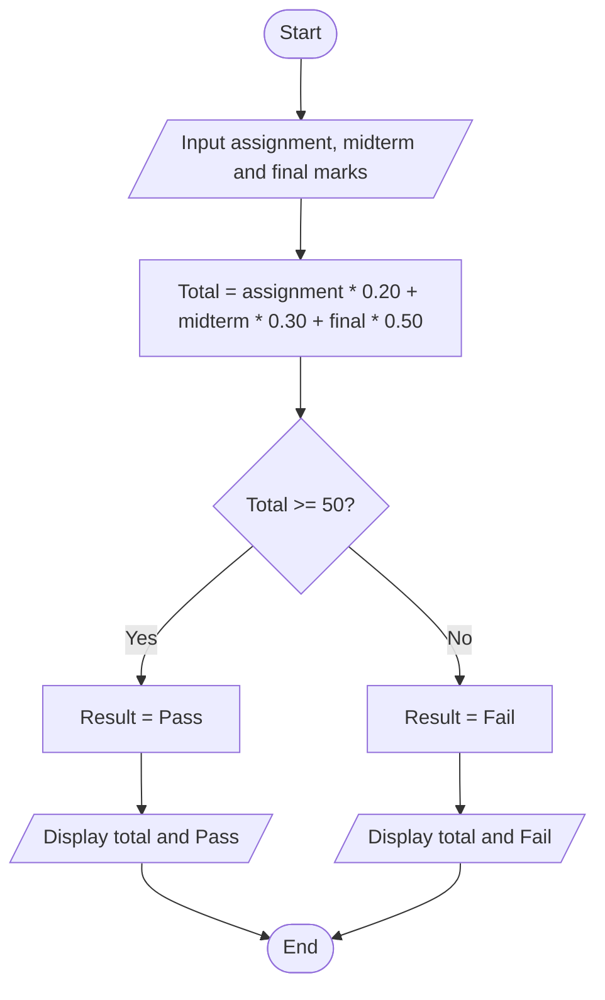
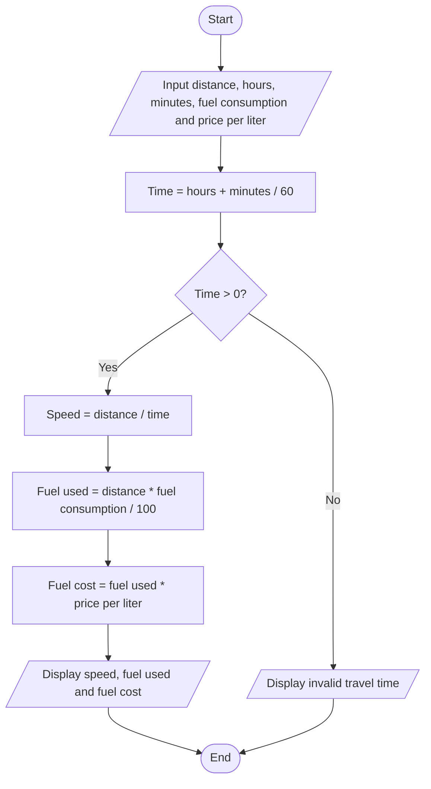

# Task 1: Student Course Total




# Task 2: Electricity Bill

```mermaid
flowchart TD
    A([START]) --> B[/Enter electricity units/]
    B --> C{Units <= 50?}
    C -->|YES| D[Energy charge = Units * 1.50]
    C -->|NO| E[Energy charge = 75 + (Units - 50) * 2.00]
    D --> F[Service charge = 10]
    E --> F
    F --> G[Total bill = Energy charge + Service charge]
    G --> H[/Print energy charge/]
    H --> I[/Print service charge/]
    I --> J[/Print total bill to 2 decimal places/]
    J --> K([END])
```


# Task 3: Trip Speed and Fuel Cost


