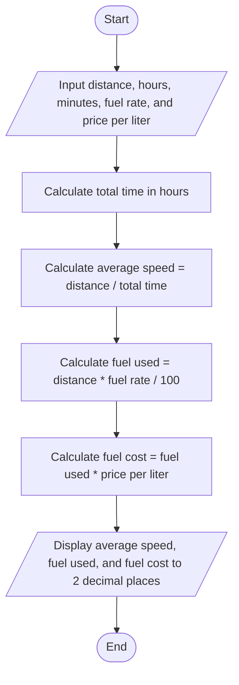

TASK 3: TRIP SPEED AND FUEL COST

A. INPUT AND OUTPUT

Input:

1. Trip distance in kilometers (km).
2. Travel time in whole hours.
3. Additional travel time in whole minutes.
4. Car fuel consumption in liters per 100 kilometers.
5. Price per liter of fuel in birr.

Outputs:

1. Average speed in kilometers per hour (km/h), displayed to two decimal places.
2. Fuel used in liters, displayed to two decimal places.
3. Fuel cost in birr, displayed to two decimal places.

B. PROCESS (NUMBERED LIST)

1. START.
2. READ distance, hours, minutes, fuel rate, and price per liter.
3. COMPUTE total time = hours + (minutes / 60.0).
4. COMPUTE average speed = distance / total time.
5. COMPUTE fuel used = (distance * fuel rate) / 100.0.
6. COMPUTE fuel cost = fuel used * price per liter.
7. DISPLAY average speed, fuel used, and fuel cost to 2 decimal places.
8. END.

C. FLOWCHART
