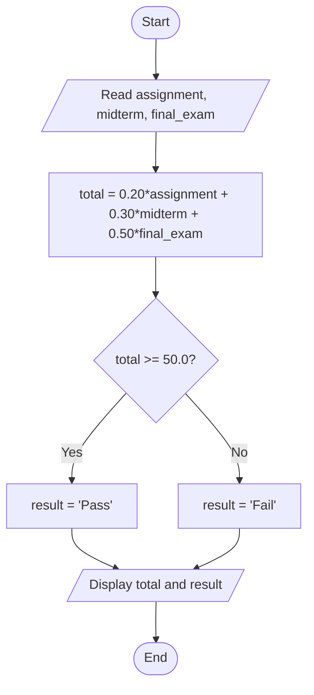
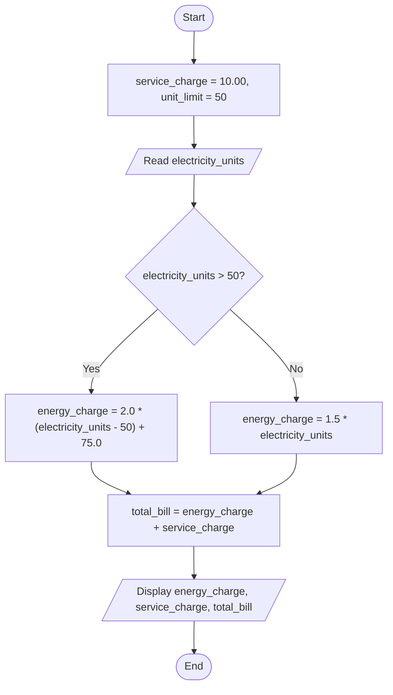
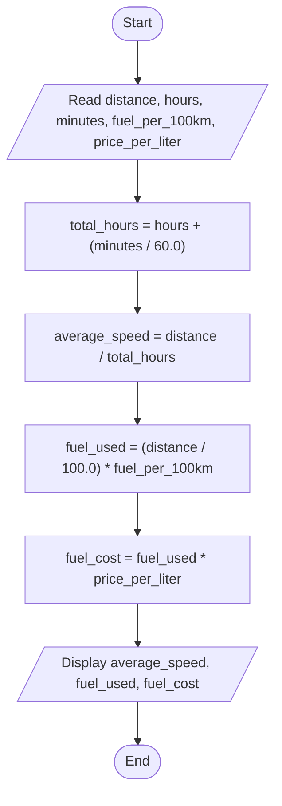

# Chapter 2 C++ Exercises — Meron Tilik (ETS 1118/18)

## Task 1: Student Course Total (`student_course_total.cpp`)

---

## Task 2: Electricity Bill (`electricity_bill.cpp`)

---

## Task 3: Trip Speed and Fuel Cost (`trip_speed_and_fuel_cost.cpp`)

