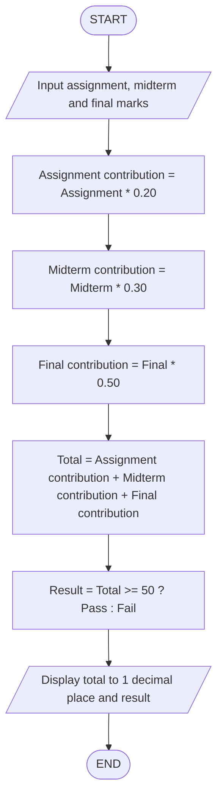
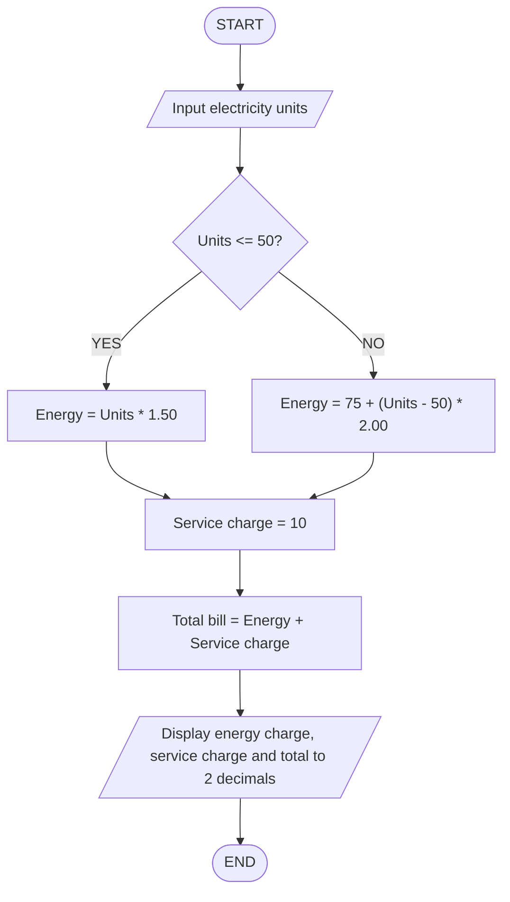
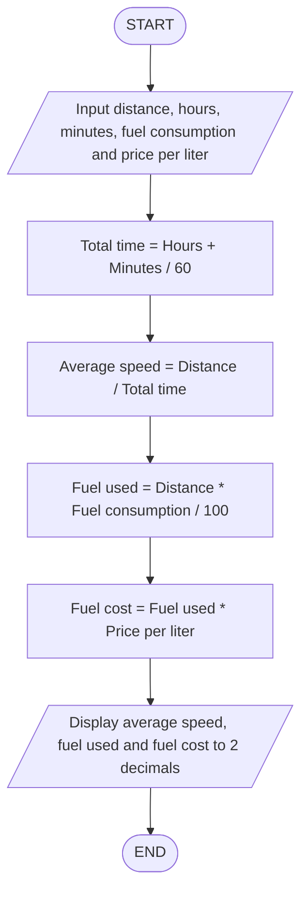

# IPO ANALYSIS – C++ ASSIGNMENT

## TASK 1: STUDENT COURSE TOTAL

### Input
- Assignment mark (out of 100)
- Midterm mark (out of 100)
- Final exam mark (out of 100)

### Process
- Assignment contribution = Assignment mark * 0.20
- Midterm contribution = Midterm mark * 0.30
- Final contribution = Final mark * 0.50
- Course total = Assignment contribution + Midterm contribution + Final contribution
- Determine result using conditional operator:
  Total >= 50 ? Pass : Fail
- Format total to one decimal place.

### Output
- Course total
- Pass or Fail

---

## TASK 2: ELECTRICITY BILL

### Input
- Electricity units consumed (kWh)

### Process
- If units are 50 or less:
  Energy charge = Units * 1.50
- If units are above 50:
  Energy charge = 75 + (Units - 50) * 2.00
- Service charge = 10 birr
- Total bill = Energy charge + Service charge
- Format all amounts to two decimal places.

### Output
- Energy charge
- Service charge
- Total electricity bill

---

## TASK 3: TRIP SPEED AND FUEL COST

### Input
- Trip distance in kilometers
- Travel time in hours
- Travel time in minutes
- Fuel consumption in liters per 100 km
- Fuel price per liter in birr

### Process
- Convert travel time into hours:
  Total time = Hours + Minutes / 60
- Calculate average speed:
  Average speed = Distance / Total time
- Calculate fuel used:
  Fuel used = Distance * Fuel consumption / 100
- Calculate fuel cost:
  Fuel cost = Fuel used * Price per liter
- Format all results to two decimal places.

### Output
- Average speed in km/h
- Fuel used in liters
- Fuel cost in birr

